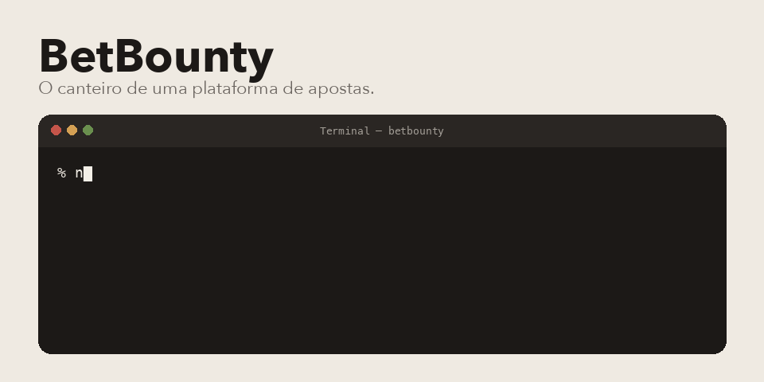

<p align="center">
  
</p>

A ideia é uma plataforma de promoções e odds. Hoje este repositório é o canteiro: sobe a API, o banco e o front. A página inicial ainda não desenha nada. As pastas de auth, promoção e scraping existem, e o código delas ainda está vazio.

A regra que eu deixei para mim está em `agent/agent.md`. Regra de negócio fica no backend. O front não inventa regra. Scraping, quando existir, mora em job. Nada de complicar antes da hora.

## Do que é feito

TypeScript nos dois lados. Fastify na API, Prisma apontando para PostgreSQL, Next.js 15 com React 19 no front. O Compose sobe os três: Postgres 16, API na 3333 e front na 3000.

## Subir

```bash
npm install
npm run docker:up
```

Sem Docker, com o Postgres no ar e o `.env` copiado dos exemplos:

```bash
cp backend/.env.example backend/.env
cp frontend/.env.example frontend/.env
npm run dev
```

`npm run dev` liga os dois workspaces. `npm run docker:down` derruba e apaga o volume.

## Onde mexer

- `backend/src/server.ts` sobe o Fastify e, por enquanto, não registra rota.
- `backend/src/modules/` é o lugar de auth, promoções, scraping e usuário.
- `frontend/src/pages/index.tsx` é a página que ainda retorna vazio.
- `docker-compose.yml` é o jeito de ter os três serviços juntos.

Pedro Américo Paletot, [peamericoo](https://github.com/peamericoo).
